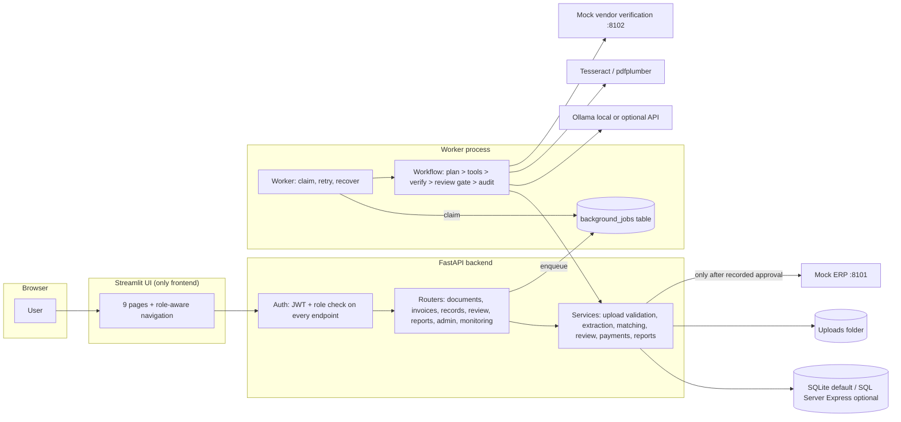
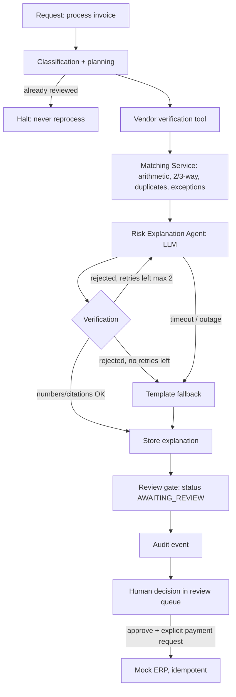
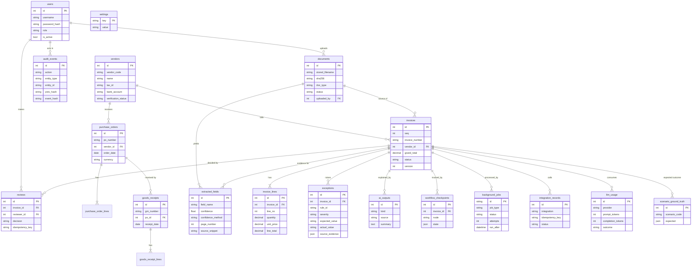
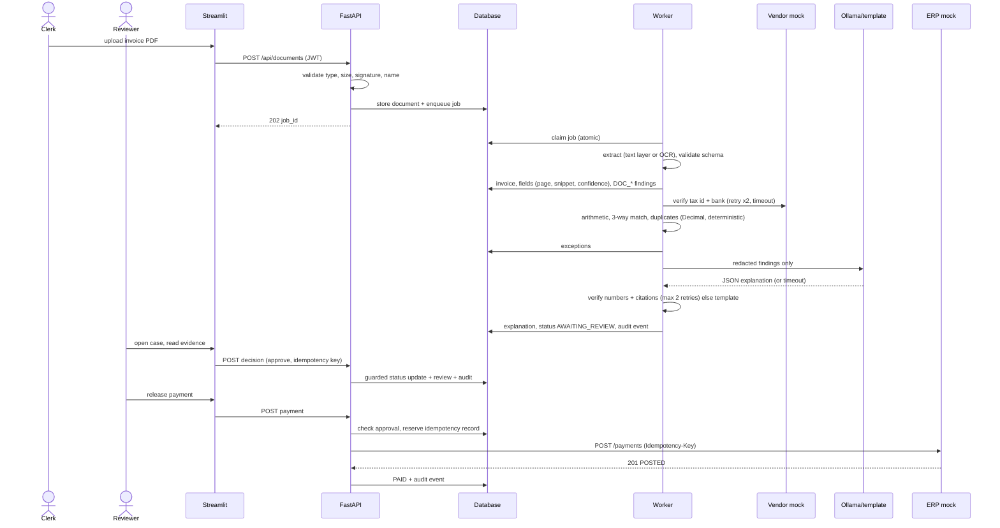

# Architecture

Diagrams are Mermaid. They render on GitHub and in VS Code (install the extension "Markdown Preview Mermaid Support", then open the Markdown preview).

## 1. System architecture

Rules of the design
- Streamlit only calls the API. No business rule lives in the UI.
- Deterministic Python code decides every financial fact. The LLM only explains stored findings, and its output is verified by code.
- Payments exist in exactly one code path (`services/payments.py`) and need a recorded human approval.
- Long work runs in the worker; the UI polls job status.

## 2. Agent / workflow graph

## 3. Entity relationship diagram

## 4. Workflow sequence (happy path with approval and payment)

## 5. Which technique does what

| Step | Technique | Why |
|---|---|---|
| Login, roles, permissions | Deterministic code | Security must be predictable |
| Document type | scikit-learn TF-IDF classifier + keyword-rule fallback | Small, fast, explainable |
| Text from PDF / scans | pdfplumber, Tesseract (measured word confidence) | Standard tools |
| Field extraction | Rule parsers + Pydantic; optional LLM mapping accepted only if the value appears verbatim in the text | Layouts vary; schema and text check catch mistakes |
| Arithmetic, matching, tolerances | Python `Decimal`, rule engine | Money must be exact and repeatable |
| Duplicates | Exact key, then RapidFuzz weighted score | Finds near-duplicates |
| Exceptions and severity | Fixed severity table | Traceable to a rule |
| Risk explanation | LLM (or template) | Plain language only |
| Verification | Deterministic validators | Stops invented numbers and citations |
| Approval | Human | Consequential action |
| Audit log | Hash-chained append-only table | Tamper-evident (not immutable) |
| Audit summary | LLM (or template) over saved events | Readable; raw events stay authoritative |
| Dashboards, reports | SQL + Python aggregation | Numbers must match the database |
